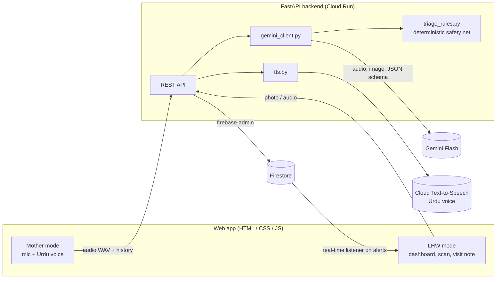

# Mamta (ممتا) — AI screens, the LHW decides

**A voice-first postpartum care companion for new mothers in Pakistan, paired with a digital workflow for Lady Health Workers.**

---

## 1. Problem statement

Most maternal and newborn deaths in Pakistan happen in the **first 6 weeks after delivery**: bleeding, infection and high blood pressure in mothers; feeding, breathing and jaundice problems in newborns. The mother is at home, often cannot read, and her only health contact is a **Lady Health Worker (LHW)** who covers about 1,000 people with a **paper register**. Danger signs go unreported, LHWs can't tell whom to visit first, and records stay handwritten.

## 2. Challenge domain & SDG alignment

**Domain:** Healthcare & Public Health

| SDG | How Mamta contributes |
|---|---|
| **3.1** Maternal mortality | Screens mothers daily for WHO postnatal danger signs (bleeding, fits, fever, high-BP symptoms) and routes RED cases to hospital + LHW within seconds. |
| **3.2** Newborn mortality | Screens babies for feeding failure, fast breathing, fever/cold and severe jaundice. |
| **3.8** Health coverage | Gives each LHW a ranked visit list, so a fixed workforce reaches the highest-risk mothers first. |
| **5** Gender equality | Puts health access in the hands of women who are often home-bound, in their own language, by voice. |
| **10** Reduced inequalities | Works for mothers who cannot read: voice in, voice out, colour + icon results. |

## 3. Solution overview

**Mother side (voice-only):** one big mic button. She speaks Urdu; Mamta (Gemini) asks up to 6 short danger-sign questions, one at a time, and replies **out loud in Urdu**. The result is a big GREEN / YELLOW / RED card. RED = "go to hospital now, your LHW has been informed".

**Nearby doctors & booking:** when the check-in ends, Mamta recommends nearby doctors matched to the problem (gynaecologist for the mother, paediatrician for the baby, 24/7 emergency first if RED) with address, distance, timings, fee and phone, and she can book the next free slot. The booking shows on her LHW's dashboard. *(Doctor directory is sample data created for the demo.)*

**LHW side:**
- **Live alerts:** a RED/YELLOW check-in appears instantly as a banner with the AI summary and the mother's own words, (Firestore real-time listener) with the reported sign and a **tap-to-call** button.
- **Today's visits:** mothers ranked RED → YELLOW → overdue routine visits (days 1, 3, 7, 42), each with a one-line reason.
- **Register digitizer:** photograph a paper register page → Gemini vision returns structured rows → unsure cells are highlighted **amber** → the LHW corrects and confirms.
- **Voice visit note:** she speaks her notes → structured visit record → she **confirms** the risk status (human in the loop).
- **Monthly report:** Gemini drafts the monthly summary from Firestore counts.

## 4. Architecture



| Google technology | What it does in Mamta |
|---|---|
| **Gemini Flash** (Gemini API / Google AI Studio) | Listens to Urdu audio and runs the triage conversation; reads handwritten register photos; turns spoken visit notes into records; drafts the monthly report. Always with `response_schema` (structured JSON). |
| **Google Cloud Text-to-Speech / Gemini TTS** | Speaks every Mamta reply in Urdu (Cloud TTS `ur-IN-Wavenet-A`; falls back to Gemini TTS `gemini-3.8-flash-lite-tts`). |
| **Firebase Firestore** | Stores LHWs, mothers, check-ins, alerts and visits; the LHW dashboard listens to `alerts` in real time. |
| **Firebase JS SDK** | Real-time Firestore listener on the LHW dashboard (`web/js/firebase-live.js`). |
| **Google Fonts** | Noto Nastaliq Urdu for readable Urdu script. |
| **Google Cloud Run** | Hosts the FastAPI backend from one Dockerfile. |
| **Firebase security rules** | Restrict each LHW to her own mothers (`firestore.rules`). |

## 5. AI models used and how

| Task | Input → Output | Model |
|---|---|---|
| Mother triage | Urdu **audio** + conversation history → `{reply_ur, done, triage, flags, transcript_turn, confidence}` | Gemini Flash `gemini-flash-latest` (fallback `gemini-3.1-flash-lite`) |
| Register digitizer | **Photo** of register page → `{rows[], low_confidence[]}` | Gemini Flash (vision) |
| Visit note | LHW **audio** → structured visit record + suggested risk | Gemini Flash |
| Monthly report | Firestore counts → Markdown draft | Gemini Flash |
| Voice reply | Urdu text → MP3 | Cloud Text-to-Speech |

All prompts are in [`backend/prompts.py`](backend/prompts.py) and all schemas in [`backend/schemas.py`](backend/schemas.py).

## 6. Responsible AI

1. **No diagnosis.** The prompts forbid diagnoses and medicine names/doses. Every triage screen says *"یہ صرف اسکریننگ ہے، طبی تشخیص نہیں — Screening result, not a medical diagnosis"*.
2. **Deterministic safety net** ([`triage_rules.py`](backend/triage_rules.py), unit-tested in `backend/tests/`). It runs after Gemini on every turn. Any RED flag, or RED words in the mother's own speech (e.g. *بہت خون، دورے، بے ہوش، سانس، نیلا*), **forces RED** and sets `ruleOverride=true`. The rules can only **escalate** risk, never lower it. The AI can also only raise a mother's stored risk status; only the LHW can lower it.
3. **Human in the loop.** Register rows and visit records are drafts until the LHW taps **Confirm**. Unsure cells are amber. The AI's suggested risk is a pre-selected chip she must confirm.
4. **Transparency.** Every AI output carries an "AI-generated" tag (or "offline demo data" when cached). Confidence is shown. See [AI_DISCLOSURE.md](AI_DISCLOSURE.md).
5. **Privacy.** There is an Urdu consent screen before the first check-in. We keep minimal data (no CNIC, house number at most). **Raw audio is never stored.** API keys stay server-side. Firestore rules limit each LHW to her own mothers.
6. **No real patient data.** Only seed data written by the team and register pages we filled in by hand.
7. **Unvalidated output isn't presented as fact.** YELLOW or low-confidence results show "Please confirm with your LHW".
8. **Fails safe.** If Gemini fails twice, the API returns YELLOW + "please contact your LHW", never GREEN.

## 7. How to run locally

**Backend (Python 3.11+)**
```bash
cd backend
python -m venv venv && venv\Scripts\activate        # macOS/Linux: source venv/bin/activate
pip install -r requirements.txt
copy .env.example .env                               # then fill GEMINI_API_KEY etc.
python -m pytest -q tests                            # safety-net + API tests
python seed.py                                       # reset demo data (<10 s)
uvicorn main:app --reload --port 8000                # http://localhost:8000/docs
```
| Env var | Meaning |
|---|---|
| `GEMINI_API_KEY` | Google AI Studio key (primary auth) |
| `GOOGLE_APPLICATION_CREDENTIALS` | Path to the Firebase service-account JSON (Firestore + Cloud TTS) |
| `FIREBASE_PROJECT_ID` | Firebase / GCP project id |
| `DEMO_MODE` | `true` = use cached fixtures if AI/network fails, `force` = always fixtures (no Wi-Fi), `false` = safe fallback only |
| `USE_MEMORY_DB` | `true` = skip Firestore, use an auto-seeded in-memory DB |

Without Firestore credentials, the backend automatically uses an in-memory DB, and the app polls instead of listening live.

**Web app (no build step)**

The backend serves the website itself. Open **http://localhost:8000/app/** in Chrome (allow the microphone).
Use one tab for **Mother** mode and one for the **LHW dashboard**. On a phone on the same Wi-Fi: `http://<laptop-ip>:8000/app/` (start uvicorn with `--host 0.0.0.0`; mic needs HTTPS on phones, so use the Cloud Run URL or ngrok there).

Optional live Firestore listener: paste your Firebase web config into `backend/web/js/firebase-config.js`.

**Deploy the backend to Cloud Run**
```bash
cd backend
gcloud run deploy mamta-api --source . --region asia-south1 --allow-unauthenticated \
  --set-env-vars GEMINI_API_KEY=...,FIREBASE_PROJECT_ID=...,DEMO_MODE=true
```

## 8. Demo script (3 minutes)

**Logins (demo accounts):** LHW Shazia Bibi: phone `03001234567`, PIN `1234`. Mothers: phone `03000000001` to `03000000006` (Fatima Noor = `03000000002`). Each browser window keeps its own login, so open the LHW and the mother in separate windows.

1. **LHW dashboard** on the projector: six mothers, all calm (2 yellow from history, 1 overdue day-7 visit).
2. **Mother mode** (second tab or phone) → consent → tap mic → *"Kal se bohat khoon aa raha hai aur chakkar aa rahe hain"*. Mamta replies by voice: go to hospital now, Shazia has been informed. The card turns **RED**.
3. The LHW dashboard instantly shows the **red alert banner**; that mother moves to the top → **Call**.
4. **Scan register** → photo of a hand-filled page → rows appear, one **amber** cell → correct it → **Confirm** → the new mothers appear in the list.
5. **Record visit note** → structured record → confirm the risk chip → saved.
6. Close: **"AI screens, the LHW decides."**

Before presenting: `python seed.py` (or the ↻ button on the home screen) resets everything.

## 9. Team members & roles

| Name | Role |
|---|---|
| _[TEAM TO FILL]_ | Backend (FastAPI, Gemini, safety net) |
| _[TEAM TO FILL]_ | Web frontend (mother + LHW UI) |
| _[TEAM TO FILL]_ | Firebase, prompts, demo & docs |

## 10. AI disclosure

See **[AI_DISCLOSURE.md](AI_DISCLOSURE.md)**.

---

Built during the CUI Tech Fest FA'26 Build with Google Hackathon on 11 Nov 2026. All core development was done during the competition period.
